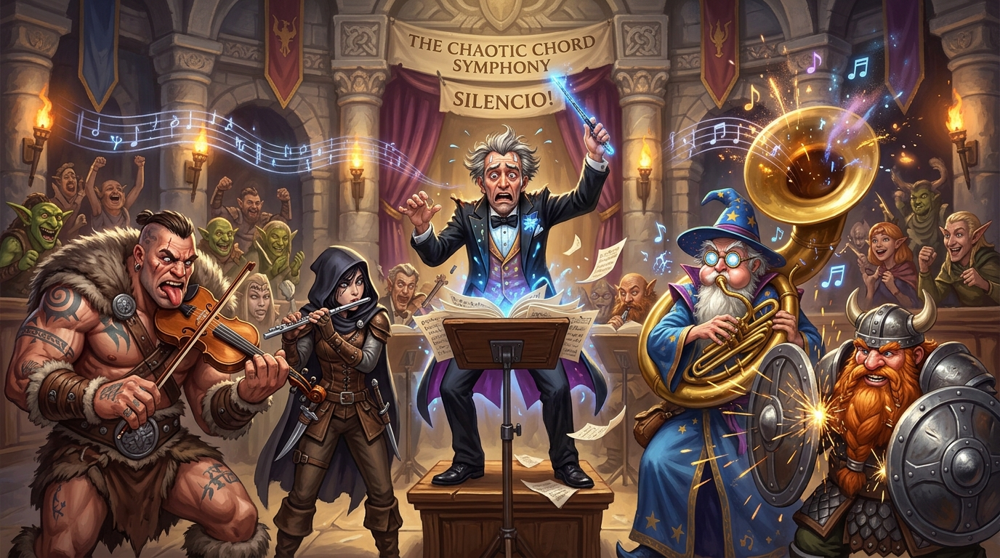

# 🧪 AID-Testbeds-Live



[](LICENSE)
[](https://github.com/viosca/aid-modules/blob/main/SPECIFICATION.md)
[]()

> Automated end-to-end live interactive playtesting suite and multi-script testbeds for **AI Dungeon**.

**`aid-testbeds-live`** is an automated playtesting framework that launches live adventures on AI Dungeon's cloud backend, wires up multi-script cascades in sequential waterfall order, issues live slash commands, drives conversational turns, and verifies lore indexing and character mind activation in real time.

Powered by [`aid-connector`](https://github.com/viosca/aid-connector), this repository serves as the ecosystem's integration testing and CI/CD verification suite.

---

## 🏗️ Architecture

```
aid-testbeds-live/
├── shared/
│   └── runner-utils.js             (sendTurn, driveContinues, polling helpers)
│
└── testbeds/
    ├── triad-waterfall/            (3-Script Cascade: Router -> Entity-Cards -> Inner Entity)
    │   └── run.js
    │
    ├── autocards/                  (Autonomous NER Lore Generation & Context Injection)
    │   └── run.js
    │
    └── waterfall/                  (Dual-Script Waterfall: Case 1 Creator vs Case 3 Host)
        └── run.js
```

---

## 🚀 Quick Start

### 1. Prerequisites
Ensure you have Node.js 18+ installed and credentials in a `.env` file:

```env
AID_ACCESS_TOKEN=your_token_here
# Or username/password for automatic headless token refreshing:
AID_EMAIL=your_email@example.com
AID_PASSWORD=your_password
```

### 2. Run Testbeds

Run the primary Triad multi-script waterfall testbed:
```bash
npm test
# or
npm run testbed:triad
```

Run the autonomous Named Entity Recognition (NER) testbed:
```bash
npm run testbed:autocards
```

Run the dual-script Case 1 & Case 3 waterfall testbed:
```bash
npm run testbed:waterfall
```

Run all live testbeds in sequence:
```bash
npm run test:all
```

---

## 📜 Active Testbeds

### 1. Triad Waterfall (`testbeds/triad-waterfall/`)
Verifies the complete 3-script cascade:
$$\text{AID-Getopt Router (v1.0.0)} \longrightarrow \text{Entity-Cards (v2.8.0-EC)} \longrightarrow \text{Inner Entity (v3.0)}$$
* **Upstream Interception:** `/aid-getopt --diag`, `/aid-modules`, and `/help` intercepted cleanly by Script 1 with early halting.
* **Downstream Passthrough:** `/ec` commands pass through Script 1 to Script 2.
* **Story Card Architecture:** Configuration cards (`Configure Auto-Cards` and `Configure Inner Self`) coexist peacefully.
* **Dual-Engine Activation:** Natural narrative prose triggers both location card generation and NPC consciousness brain state indexing (`🎭 Balin`).
* **Context Telemetry:** Verifies deterministic model context injection (>3,200 chars).

### 2. Auto-Cards Autonomous (`testbeds/autocards/`)
Verifies passive Named Entity Recognition (NER) in story prose without requiring player slash commands.
* Introduces novel entities into story dialogue.
* Verifies cooldown handling, trigger keyword padding, and story card creation.
* Asserts prompt payload integrity under `World Lore:`.

### 3. Waterfall Modes (`testbeds/waterfall/`)
Verifies sequential script execution across both AI Dungeon deployment topologies:
* **Case 1:** Built-in shared library script + Attached script.
* **Case 3:** Blank scenario + Dual attached scripts.

---

## 📄 License

MIT © Randy Viosca ([@Random_Variable](https://github.com/viosca))
